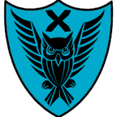

<p align="center">
  
</p>
<h1 align="center">OverchanX</h1>

---

## Изменения относительно оригинального Overchan

### Сборка и совместимость с современным Android
- Миграция с Ant и Eclipse ADT на Gradle (Android Gradle Plugin 9.x).
- Миграция устаревшей библиотеки android-support-v4 на AndroidX (Core, Fragment, DrawerLayout, ViewPager, Collection).
- Обновлены версии SDK: minSdk повышен до 24 (Android 7.0), compileSdk и targetSdk обновлены до 36.
- Проект переведён на Java 17. Сгенерирован стандартный Gradle Wrapper (`./gradlew`).

### Видеоплеер ExoPlayer
- В галерею интегрирован современный видеоплеер ExoPlayer (v2.19.1) с аппаратным ускорением и поддержкой форматов WebM и MP4.
- Добавлен выбор режима управления ExoPlayer в настройках галереи (пункт отображается только при выборе ExoPlayer в качестве плеера):
  - Компактная полоса перемотки (выбрана по умолчанию) — нижний ползунок SeekBar с отображением текущего и общего времени, перемотка двойным тапом на 5 секунд.
  - Двойной тап — перемотка тапом по левой/правой части экрана на 5 секунд с экранным индикатором.
  - Штатная панель ExoPlayer — стандартные наэкранные кнопки управления воспроизведением.

## Сборка проекта (Building Source Code)

### Требования
- JDK 17 или новее.
- Android SDK (платформа API 36, Build-Tools).
- Android NDK (при необходимости сборки JNI-компонентов giflib).

### Сборка через Gradle
Клонируйте репозиторий и выполните команду в корневой папке проекта:

Linux / macOS:
```bash
./gradlew assembleDebug
```

Windows:
```cmd
gradlew.bat assembleDebug
```

Собранный файл будет находиться по пути:
`build/outputs/apk/debug/OverchanNext-debug.apk`

### Импорт в Android Studio
1. Откройте Android Studio.
2. Выберите **File -> Open...** и укажите папку проекта.
3. Дождитесь синхронизации Gradle и нажмите **Run** или соберите APK через **Build -> Build Bundle(s) / APK(s) -> Build APK(s)**.

## Поддерживаемые имиджборды
Список поддерживаемых бордов: [Imageboards.md](Imageboards.md)

## Лицензия
OverchanX распространяется под лицензией [GPLv3](LICENSE.txt).
